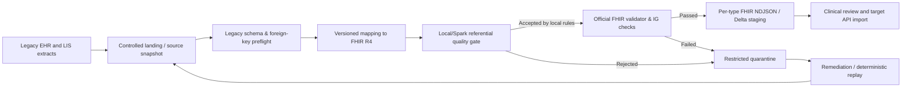

# Migration architecture: legacy healthcare records to a governed FHIR R4 lakehouse

## Why a FHIR-compatible migration needs more than a JSON parser

A vendor might export patient, encounter and laboratory observation tables as
flat files. Converting one row into a syntactically plausible FHIR resource is
relatively easy; proving that the *dataset* remains referentially intact is not.
A lab result can be valid JSON and still refer to a different patient's
encounter, or to a patient excluded from the batch.

FHIR data quality is a multi-layer problem:

1. **Source contracts**: expected columns, nullability, business identifiers,
   source system semantics and change detection.
2. **Mapping**: stable identity, UCUM quantity units, event timestamps, relevant
   terminology systems and FHIR resources.
3. **R4 conformance**: structural definitions, profile cardinality, FHIRPath
   invariants, terminology bindings and relevant Implementation Guides.
4. **Migration integrity**: reference resolution, duplicates, reconciliation,
   chronology, quarantines and reprocessing after remediation.
5. **Operational safety**: authorization, PHI access controls, encryption,
   retention, audit trails, schema version pinning and a release gate.

This repository implements useful parts of **1, 2, 4 and 5**. It implements a
**small explicit subset of 3** and requires the official HL7 validator and
relevant Implementation Guides as a separate stage for conformance testing.

## Suggested enterprise flow

The process should preserve a source snapshot identifier and immutable mapping
version. No clinical payload is included in metrics, traces or CI tests. Apply
technical and clinical go/no-go criteria before loading a production FHIR
server. Keep FHIR `Provenance`/`AuditEvent` strategy separate and design it with
the receiving system: a single `meta.tag` is not a replacement for provenance.

## Dependency-closed quarantine

A source resource being present is not enough: it may itself be rejected. The
local validator builds a reference index, computes row-level errors, and then
marks *transitively dependent* resources as rejected using a recursive SQLite
set operation. For example, an invalid Patient makes the corresponding
Encounter ineligible; an Observation referencing that Encounter is ineligible
even when its own fields look sound. Cycles without an invalid root are not
rejected merely because a cycle exists. This is three input passes, trading
sequential I/O for referential closure without loading the graph into Python
memory. Arbitrary external references cannot be resolved this way.

When running against a partial dataset, the dependency closure only covers
resource keys present in that dataset. A separately governed target reference
service is still needed to validate cross-batch relationships.

## Snapshot comparison and release integrity

`compare_snapshots` uses an ephemeral SQLite index with domain-separated
HMACs of resource keys and canonical content. It compares logical R4 resource
identities without publishing identifiers, patient names or actual record
diffs. It distinguishes `unobserved` keys from `deleted` *candidates* until
an operator explicitly asserts identical complete extraction scope for both
sides. A complete assertion never executes deletes; actual deletion handling
is a target-specific clinical/governance operation.

`inventory create` hashes local accepted NDJSON files and records byte counts
and type-homogeneous resource counts. `inventory verify` detects changes
between staging and handoff. SHA-256 content hashes can still be sensitive
correlation material, so inventory reports stay inside protected storage.

`inspect-export` reads an HL7 Bulk Data output manifest but deliberately does
not request network URLs or authentication. An authorized download client
must save those files first. This prevents a quality-gate job from becoming an
unreviewed patient-data transfer client or SSRF vector.

## Source preflight

`fhir-quality profile-legacy --input ./legacy --fail-on-issues` scans source
CSV data without materializing original IDs in the profiling index. It checks
source schema drift, duplicate surrogate keys, missing patient or encounter
foreign keys, observation/encounter patient mismatch and basic date/code
presence. Missing optional patient birthdates are reported but not blockers.

The profiler intentionally fails closed if reference datasets are absent. A
partial migration is possible, but to support it the operator must supply an
explicit existing target reference index and appropriate open-world policy; the
current profiler does **not** infer that a missing source means a valid target.

## Identity and replay

`stable_id(config, kind, legacy_key)` uses HMAC-SHA256 over namespace, resource
type and source key. Benefits:

- repeatable IDs across source snapshots with the *same* secret and namespace;
- ID scope separation (a Patient key cannot collide trivially with Encounter);
- low likelihood of exposing a guessable source patient key through a naked hash.

Trade-offs and constraints:

- secret rotation changes generated logical IDs unless a managed identity map
  and transition process is in place;
- patient entity resolution across EHRs is a separate, governed master patient
  index problem (this tool does **not** equate persons from matching names/DOB);
- HMAC-based resource IDs are still potentially personal data and do not
  constitute anonymization;
- an idempotent target import requires an upsert or version-aware transaction
  strategy in addition to deterministic IDs. `mode('append')` on Delta is not
  automatically idempotent.

## Referential semantics

FHIR references may be relative (`Patient/123`), versioned
(`Patient/123/_history/4`), contained (`#x`), absolute, conditional or
Bundle-local (`urn:uuid:...`).

- Relative references resolve by `resourceType/id` in the available index.
- Versioned references are checked for logical-resource presence, **not** the
  specific historical version. Historical version fidelity must be checked
  against a FHIR server with version history.
- Contained references resolve against the current resource's `contained` list.
- Bundle-local `fullUrl` aliases are scoped to each Bundle, preventing a UUID
  reused in another unrelated Bundle from being mistaken as an alias.
- External, conditional and unknown absolute references are *not* fetched
  automatically. They produce `DQ_REFERENCE_NOT_CHECKED` warnings. A real
  migration needs an explicit, authorized target master-data lookup.
- In `closed` mode, missing local relative references quarantine; in `open`
  mode they warn. Open is not the same as verified.

## Clinical-quality rules are not treatment decisions

Observation-to-Encounter patient mismatch is a useful data correctness signal
for clinical events that are expected to belong to the same Patient. It is a
**configurable migration contract**, not a universal FHIR R4 requirement.
Similarly, an Observation preceding `Patient.birthDate` should be investigated,
but clinical history imports can contain deliberately imprecise dates and
administrative correction artifacts. This prototype only compares full dates,
not partial dates, and does not infer a medical conclusion from a violation.

A complete laboratory migration additionally needs:

- LOINC verification (including panels and components) and terminology mapping;
- reliable UCUM dimensional checks and unit-conversion policy;
- interpretation ranges, abnormal flags, provenance and result status mapping;
- business-approved choices for canceled/amended/corrected results;
- preservation of clinically relevant history and temporal provenance;
- FHIR profiles imposed by local/national programs or receiving EHR.

No third-party terminology server is queried here. An offline allowlist is an
*operator-maintained contract*, not an authoritative implementation of LOINC,
SNOMED CT or UCUM terminology semantics.

## Spark/Databricks design choices

Spark handles the same pipeline differently from the local two-pass validator.
The optional module assumes a batch DataFrame containing JSON strings and
builds Catalyst `get_json_object`, `regexp_extract`, `groupBy` and `join`
expressions. This avoids Python UDF serialization on every row, scales beyond
a single Python process, and leaves DataFrames lazy for orchestration.

The Spark checks are *deliberately narrower* than the two-pass validator, as
listed in the README. They do not implement all nested reference extraction,
terminology, temporal or full conformance checks. For a real Azure pipeline:

1. Ingest one immutable source snapshot and stamp a stable `batch_id`.
2. Parse `Patient`, `Encounter` and `Observation` from a controlled bronze
   landing zone, preserving raw JSON only in restricted storage.
3. Deduplicate or explicitly quarantine conflicting keys. Enforce deterministic
   key mapping and maintain target crosswalks for incremental imports.
4. Broadcast small reference tables only when materially beneficial, and
   benchmark joins on real cardinalities; avoid blanket broadcast hints.
5. Persist accepted/quarantine/issue DataFrames to restricted Delta datasets,
   partitioning by a meaningful batch/release ID. Use overwrite on **distinct
   batch paths** or transactionally managed `MERGE`, never uncontrolled append.
6. Run a separate official FHIR validator on samples/all rows as required by
   risk profile; pin R4/IG package versions, record the validator version.
7. Reconcile accepted + quarantined = submitted resource count, separately
   reconcile original source rows vs mapped rows and source-column drop rates.
8. Release to the target FHIR API only after clinical, privacy and technical
   acceptance. Hold discrepancies in quarantine until investigated.

For very large datasets, the local SQLite index may be operationally unsuitable
(e.g., limited disk or many millions of linked observations). Use the Spark
path or a partitioned index and test actual cardinality, skew, shuffle cost and
throughput on your target Azure Databricks Runtime. Do not extrapolate the
local laptop benchmark to a cluster.

## Known gaps: candidate upstream contributions

- Validating against official StructureDefinitions/IG package snapshots;
- clinically reviewed terminology and UCUM conversion policies;
- FHIR R4B/R5 version-aware mapping with explicit migration diff rules;
- more robust handling of references represented by identifiers or conditional
  expressions, and remote master-data verification under authorization;
- source CDC watermark reconciliation and target-specific exactly-once imports;
- support for more resource families (MedicationRequest, DiagnosticReport,
  Procedure, Condition, Claim) with tested domain policies;
- Delta performance tests on realistic skew and wide JSON payloads;
- standardized FHIR `Provenance` and reconciliation manifests;
- adversarial fuzzing, audit hardening and formal privacy review.

The priority is **accuracy before coverage**. It is better to publish a narrow
reproducible contract than to imply full HL7/national interoperability with
heuristics.
